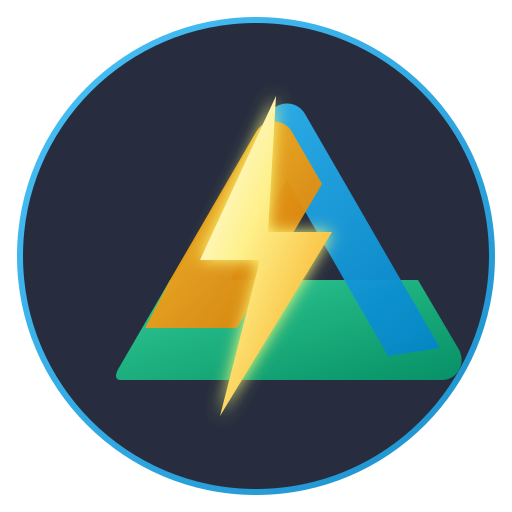

<p align="center">
  
</p>

<h1 align="center">DriveKit</h1>

<p align="center">
  <strong>أداة ومكتبة Google Drive فائقة السرعة والمرونة للمطورين (JavaScript & TypeScript)</strong>
</p>

<p align="center">
  <a href="https://moaaz-i.github.io/drivekit/"></a>
  <a href="https://opensource.org/licenses/MIT"></a>
  <a href="https://www.typescriptlang.org/"></a>
  <a href="https://nodejs.org/"></a>
  <a href="https://github.com/Moaaz-i/drivekit"></a>
</p>

> 📚 **التوثيق الشامل**: تصفح الدليل التفاعلي ومرجع الدوال والأمثلة باللغتين العربية والإنجليزية على **[moaaz-i.github.io/drivekit](https://moaaz-i.github.io/drivekit/)**.

---

## 🌟 لماذا DriveKit؟

التعامل المباشر مع مكتبات Google Drive الرسمية مليء بالتعقيدات:
- ❌ لا يوجد نظام مسارات حقيقي (تحتاج يدوياً للبحث عن معرف المجلد `folderId` خطوة بخطوة).
- ❌ رفع الملفات الكبيرة يتطلب كتابة مئات أسطر الكود للتعامل مع الرفع المتقطع والقطع وحسابات البايتات.
- ❌ مواجهة مشاكل تجاوز كوتا الاستعلامات (429 Rate Limits) وتوقف العمليات.
- ❌ كتابة استعلامات البحث كسلاسل نصية SQL معقدة ومعرضة للأخطاء الإملائية والهروب (Escaping).
- ❌ صعوبة تنزيل وتصدير مستندات Google Docs و Sheets و Slides إلى PDF أو Excel.

**DriveKit تحل كل هذه المشاكل بأسلوب ساحر!**

---

## ✨ المميزات الرئيسية

1. 📂 **نظام مسارات افتراضي ذكي (Virtual Path System)**:
   - تعامل مع Google Drive كنظام ملفات حقيقي: `drive.mkdirp('/Backups/2026')` أو الرفع المباشر إلى مسار: `parent: '/Projects/App'`.
   - تخزين مؤقت تلقائي لمسارات المجلدات لتسريع العمليات وتوفير استعلامات الـ API.

2. ⚡ **محرك السرعة القصوى (DriveKit Turbo Engine)**:
   - **تجميع وإعادة استخدام الاتصالات (Keep-Alive)**: الحفاظ على حتى 64 قناة اتصال مفتوحة لتجاوز بطء مصافحة أمان TLS في كل طلب.
   - **دمج الطلبات المتزامنة (In-Flight Request Coalescing)**: توحيد استعلامات المسارات المتزامنة في طلب شبكي واحد وحماية من تكرار المجلدات.
   - **تخزين مؤقت استباقي للشجرة (Opportunistic Tree Caching)**: استعلام `drive.ls()` يفهرس فوراً أبناء المجلد ومساراتهم في SQLite، ليكون الاستعلام اللاحق في **0.03 مللي ثانية (0ms Hit)**.
   - **مسار الرفع السريع للملفات الصغيرة (≤ 5MB)**: رفع مباشر في طلب واحد مع الحفاظ على تنبيهات التقدم اللحظية.
   - **حجم قطع متكيف (Adaptive Chunk Sizing)**: ترقية حجم القطع تلقائياً إلى 16MB و 32MB للملفات الكبيرة والعملاقة.

3. 💾 **كاش دائم محلي في 0ms عبر SQLite**:
   - فهرسة محلية للملفات والمجلدات عبر `node:sqlite` المدمج في Node 22 (مع بديل In-Memory تلقائي في البيئات السابقة).

4. 🖥️ **خادم WebDAV مدمج (RFC 4918)**:
   - ربط Google Drive كمساحة ملفات شبكية مباشرة في macOS Finder و Windows Explorer مع مصادقة HTTP Basic Auth.

5. 🌊 **دعم كامل لتدفقات Node.js وطلبات النطاق الجزئي (HTTP 206)**:
   - قراءة وكتابة التدفقات عبر `createReadStream` و `createWriteStream` بذاكرة وسيطة سعتها 1MB لأقصى استغلال لسرعة الشبكة.

6. 🧩 **نظام إضافات معياري (Plugins Architecture)**:
   - خطافات دورة حياة العمليات (`beforeUpload`, `afterUpload`, `beforeDownload`, `afterDownload`) مع إضافات جاهزة مثل التسمية التلقائية بالوقت و Webhooks.

7. 🚀 **محرك رفع متقطع فائق السرعة (Resumable Chunked Uploader)**:
   - رفع آمن للملفات الضخمة باستئناف تلقائي عند انقطاع الشبكة.
   - تتبع حي ودقيق: **نسبة الإنجاز %**، **سرعة الرفع الحالية (MB/s)**، **الوقت المتبقي المقدر (ETA)**.

8. 🔍 **باني استعلامات سلس (Fluent Query Builder)**:
   - كتابة استعلامات نظيفة وسلسة وسهلة القراءة بأسلوب السلسلة (Chaining).

9. 🛡️ **مقاومة أخطاء الشبكة والكوتا (Exponential Backoff with Full Jitter)**:
   - إعادة محاولة ذكية وتلقائية عند مواجهة `429 Too Many Requests` أو `5xx Backend Errors`.

10. ⚡ **مزامنة المجلدات بالتوازي (Parallel Sync Engine)**:
    - رفع وتنزيل مجلدات كاملة بجميع تفرعاتها بالتوازي مع التحكم في عدد المسارات المتزامنة.

11. 📄 **تصدير مستندات Google تلقائياً**:
    - تحويل Google Docs إلى PDF أو Docx، و Sheets إلى Excel أو CSV، و Slides إلى PDF بلمسة واحدة.

12. 🔗 **مشاركة فورية للملفات**:
    - تحويل أي ملف إلى عام بلمسة واحدة والحصول على رابط العرض والرابط المباشر للتحميل.

13. 💻 **أداة سطر أوامر مدمجة (CLI)**:
    - تشغيل مباشر من الطرفية عبر `drivekit ls` أو `drivekit upload` أو `drivekit sync`.

---

## 📦 التثبيت

```bash
npm install drivekit
# أو
pnpm add drivekit
# أو
yarn add drivekit
```

---

## 🔑 خيارات المصادقة السريعة

يدعم **DriveKit** كافة طرق المصادقة الشائعة:

### 1. عبر ملف Service Account (الأكثر شيوعاً للمخدمات والبوتات):
```typescript
import { createDrive } from 'drivekit';

const drive = await createDrive({
  auth: {
    keyFilePath: './service-account.json', // أو عبر متغير البيئة GOOGLE_APPLICATION_CREDENTIALS
  },
});
```

### 2. عبر رمز الدخول المباشر (Access Token):
```typescript
const drive = await createDrive({
  auth: { accessToken: 'ya29.a0AfH...' }
});
```

### 3. عبر OAuth2:
```typescript
const drive = await createDrive({
  auth: {
    oauth: {
      clientId: 'YOUR_CLIENT_ID',
      clientSecret: 'YOUR_CLIENT_SECRET',
      refreshToken: 'YOUR_REFRESH_TOKEN',
    }
  }
});
```

---

## 🚀 أمثلة عملية

### 1. رفع ملف مع تتبع السرعة ونسبة الإنجاز
```typescript
const file = await drive.upload({
  source: './database-backup.zip', // مسار ملف محلي أو Buffer أو Stream
  name: 'db-backup-2026.zip',
  parent: '/Backups/Databases', // مسار افتراضي (يتم إنشاؤه تلقائياً إن لم يوجد!)
  overwrite: true,
  onProgress: (p) => {
    console.log(`نسبة الإنجاز: ${p.percentage}% | السرعة: ${p.speedFormatted} | متبقي: ${p.estimatedTimeRemainingSeconds} ثانية`);
  },
});

console.log(`تم الرفع بنجاح! معرف الملف: ${file.id}`);
```

### 2. البحث والاستعلام بأسلوب سلس (Query Builder)
```typescript
const files = await drive.query()
  .nameContains('invoice')
  .mimeType('application/pdf')
  .notTrashed()
  .modifiedAfter('2026-01-01')
  .orderBy('modifiedTime desc')
  .pageSize(20)
  .list();

for (const f of files) {
  console.log(`- ${f.name} [${f.id}]`);
}
```

### 3. تنزيل ملف أو تصدير مستند
```typescript
// تنزيل ملف وحفظه في مجلد محلي
await drive.download('FILE_ID_OR_PATH', {
  destination: './downloads',
  onProgress: (p) => {
    console.log(`تم تنزيل: ${p.bytesRead} بايت بسرعه ${p.speedFormatted}`);
  }
});
```

### 4. قراءة محتوى نصي أو JSON مباشرة
```typescript
// قراءة ملف JSON من الدرايف مباشرة
const config = await drive.getJson('/Config/settings.json');
console.log(config);

// قراءة نص
const text = await drive.getText('/Notes/todo.txt');
```

### 5. مشاركة الملف والحصول على الروابط
```typescript
// جعل الملف متاحاً لأي شخص لديه الرابط والحصول على رابط مباشر
const links = await drive.sharePublic('FILE_ID_OR_PATH');
console.log('رابط المعاينة:', links.previewLink);
console.log('رابط التحميل المباشر:', links.directDownloadLink);

// أو مشاركته مع بريد محدد
await drive.share('FILE_ID', {
  role: 'writer',
  emailAddress: 'colleague@example.com',
  sendNotificationEmail: true,
});
```

### 6. مزامنة مجلد كامل بالتوازي (Folder Sync)
```typescript
const result = await drive.syncFolder('./my-project-build', '/Builds/Release-v1', {
  concurrency: 5, // رفع 5 ملفات بالتوازي
  overwrite: true,
  onFileComplete: (path, id) => {
    console.log(`تم رفع: ${path}`);
  }
});

console.log(`تمت مزامنة ${result.uploaded.length} ملف بنجاح في ${result.durationMs / 1000} ثانية!`);
```

---

## 💻 استخدام أداة سطر الأوامر (CLI)

يمكنك استخدام الأداة مباشرة من الطرفية:

```bash
# عرض المساحة التخزينية والكوتا
npx drivekit quota -k ./service-account.json

# استعراض المجلدات
npx drivekit ls /Backups -k ./service-account.json

# رفع ملف مع شريط تقدم حي وحساب السرعة
npx drivekit upload ./video.mp4 /Videos -k ./service-account.json

# تنزيل ملف
npx drivekit download FILE_ID ./destination -k ./service-account.json

# مشاركة ملف وجعله عاماً
npx drivekit share FILE_ID -k ./service-account.json

# مزامنة مجلد كامل تفرعياً
npx drivekit sync ./dist /Websites/Production -c 6 -k ./service-account.json
```

> **ملاحظة**: إذا قمت بضبط متغير البيئة `export GOOGLE_APPLICATION_CREDENTIALS="./service-account.json"`، فلن تحتاج لتمرير خيار `-k` في كل مرة!

---

## 📚 موقع التوثيق الرسمي (VitePress)

تم بناء موقع توثيق تفاعلي كامل ومزدوج اللغة (عربي / إنجليزي) عبر **VitePress**:

```bash
# تشغيل موقع التوثيق محلياً (وضع التطوير)
npm run docs:dev

# بناء نسخة الإنتاج لموقع التوثيق
npm run docs:build

# معاينة النسخة المبنية
npm run docs:preview
```

---

## 🧪 الاختبارات والبناء

```bash
# تشغيل جميع الاختبارات
npm test

# فحص الأنواع وبناء الحزمة
npm run build
```

---

## 📄 الترخيص
MIT License - متاح للاستخدام التجاري والشخصي بحرية تامة.

